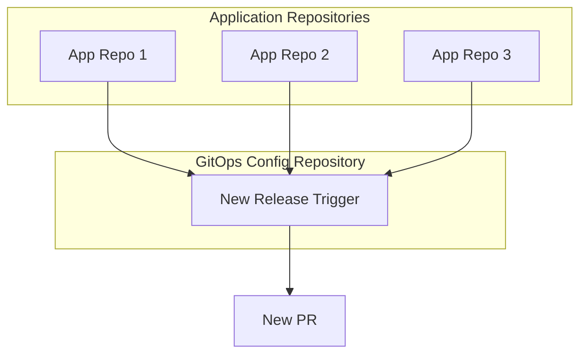
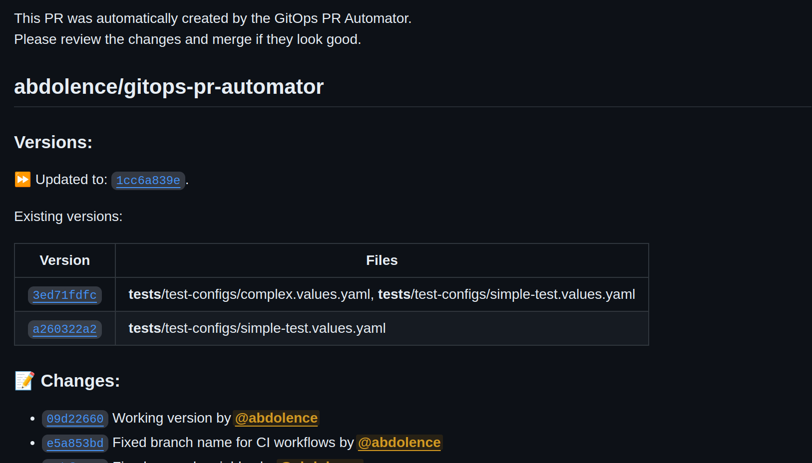

# GitOps PR Automator

[](https://github.com/super-linter/super-linter)

[](https://github.com/abdolence/gitops-pr-automator/actions/workflows/check-dist.yml)
[](https://github.com/abdolence/gitops-pr-automator/actions/workflows/codeql-analysis.yml)
[](./badges/coverage.svg)

This GitHub Action streamlines your GitOps workflow by automating the process of
updating version references within your GitOps configuration repository. By
creating pull requests (PRs) with updated versions, it helps maintain
consistency and reduces manual intervention.

A pull request is automatically created against the GitOps repository,
containing the updated version references. This PR is ready for review and
merging into your main branch, triggering your GitOps reconciliation process.

To use this action, you need a central GitOps repository where your
environment-specific configurations are stored.



Pull requests are created when a new release is detected in the source
repositories with changes history. 

## Usage

### Create a config file in your GitOps config repository

You can create multiple config files in your GitOps repository, each containing
different references to the source repositories and other parameters. The file
is read from the workflow workspace, so the workflow must check out the GitOps
repository. All options are described in
[Configuration options](#configuration-options).

```yaml
# Unique identifier for the configuration, important to have unique ids for each
# configuration and it will be used to create branch names
id: gitops-pr-automator
# Parameters for the PRs created
pullRequest:
  title: 'GitOps automated release'
  githubLabels:
    - gitops
    - gitops-test
  enableAutoMerge: 'squash'
  pullRequestComment: |
    This PR was automatically created by the GitOps PR Automator.
    Please review the changes and merge if they look good.
  commitHistory:
    disable: false # You can disable commit history in the PR
    onlyMergeCommits: false # You can include only merge commits in the PR

#  Manage the PRs lifecycle created by the action,
#  see "Pull request options" below
#  alwaysCreateNew: true
#  leaveOpenOnlyNumberOfPRs: 2

# You can define regex patterns for all release files and
# override them for specific release files
# regex:
#  - '(?<=(tag: ))[a-f0-9]{40}(?=(.*))'
# Source repositories to monitor for new releases
sourceRepos:
  - repo: abdolence/gitops-pr-automator # Repository to monitor
    ref: heads/master # Branch to monitor
    releaseFiles: # Files to monitor for new releases in GitOps config repository
      - path: '**/*.values.yaml' # Glob syntax to match files
        # Regex to both match and replace the version in the file
        # The regex uses lookbehind and lookahead assertions
        # to match the version string and replace it
        regex:
          - '(?<=(tag: ))[a-f0-9]{40}(?=(.*))'
```

This configuration file will monitor the `abdolence/gitops-pr-automator`
repository for new releases on the `master` branch. When a new release is
detected, the action will create a PR in the GitOps config repository with the
updated version references in the `*.values.yaml` files in GitOps config
repository. You can specify multiple `sourceRepos` in the configuration file to
monitor.

Pay attention to the `regex` field in the configuration file which describes
both:

- How to match the version string in the file
- How to replace the version string in the file

The whole text matched by a regular expression is replaced with the new version.
Lookbehind and lookahead assertions (`(?<=...)` and `(?=...)`) check the text
around the version without making it part of the match, so they are the way to
anchor the version to its key and leave the key as it is.

In this example, the action will look for a string of 40 hexadecimal characters
following `tag:` and replace it with the new version. You can specify multiple
`regex` in the configuration file to match and replace. Expressions run with the
`g` and `m` flags, and every match of the expression in a file is replaced.

Some other useful examples of regular expressions:

- `(?<=(tag: ))[0-9]+\.[0-9]+\.[0-9]+(?=(.*))` - match and replace semantic
  versioning
- `(?<=(image.tag\n(\s)*value:\s))[a-f0-9]{40}(?=(.*))` - match and replace the
  version in the Helm chart values file

### Create a GitHub Action workflow in your GitOps config repository

Create a GitHub Action workflow in your GitOps repository that uses this action.
The release files are found in the workflow workspace, so the workflow needs a
checkout step before the action.

```yaml
name: GitOps PR Automator
on:
  workflow_dispatch:
    inputs:
      # Optional, see the `versions` input below
      versions:
        description: 'Versions to set instead of the head of the source repos'
        required: false

concurrency:
  group: ${{ github.workflow }}
  cancel-in-progress: true

jobs:
  create-pr:
    name: Create a PR with updated version references
    runs-on: ubuntu-latest

    # These permissions are sufficient only if GitHub App token is used.
    permissions:
      contents: read

    steps:
      - name: Checkout
        id: checkout
        uses: actions/checkout@v7

      - name: Create GitOps PR
        id: create-pr
        uses: abdolence/gitops-pr-automator@v1
        # Use abdolence/gitops-pr-automator@v1.5.0 to pin the exact release
        with:
          # GitHub token with permissions to read the source repositories
          # and create PRs in this one. This token should be fine-grained since
          # it requires content write permissions.
          github-token: ${{ secrets.GH_AUTOMATION_TOKEN }}
          #
          # Another option is that you can provide a separate token
          # with read permissions to the repos.
          # github-token: ${{ secrets.GITHUB_TOKEN }}
          # github-token-read-repos: ${{ secrets.GH_AUTOMATION_TOKEN_READ_REPOS }}
          #
          # Configuration file path in the repository
          config-path: '.github/gitops/gitops-pr-automator.config.yaml'
          # Versions provided by the workflow trigger
          # versions: ${{ inputs.versions }}
          # You can override the configuration file parameters with:
          # config-override: |
          #   pullRequest:
          #    githubLabels:
          #    - gitops-test-override
```

The `@v1` reference follows the latest `v1.x.y` release; `@v1.5.0` pins the
exact release.

### Trigger the action from your source repositories

Update the source repositories to trigger the action when a new release is
detected with this step.

```yaml
- name: Trigger GitOps PR automation
  if: github.ref_protected
  uses: actions/github-script@v9
  with:
    # GitHub token with permissions to trigger workflows in the GitOps
    github-token: ${{ secrets.GH_TRIGGER_WORKFLOWS }}
    script: |
      await github.rest.actions.createWorkflowDispatch({
        owner: '<your-github-owner>',
        repo: '<your-gitops-config-repo>',
        workflow_id: '<github-actions-workflow-file-name>.yaml',
        ref: 'master'
      })
```

`ref` is the branch of the GitOps repository that the workflow runs on. The
workflow file must declare the `workflow_dispatch` trigger.

To tell the action which versions were released, instead of reading the head of
each source repository, pass them as a workflow input and forward the input to
the `versions` input of the action, as in the workflow above:

```yaml
            await github.rest.actions.createWorkflowDispatch({
              owner: '<your-github-owner>',
              repo: '<your-gitops-config-repo>',
              workflow_id: '<github-actions-workflow-file-name>.yaml',
              ref: 'master',
              inputs: {
                versions: '<your-github-owner>/<source-repo>=v1.2.3,<commit-sha>'
              }
            })
```

## Configuration options

A configuration file is a YAML document with these top-level options:

- `id` (required): unique identifier of the configuration. Branch names of the
  pull requests start with it, and the action finds its own open pull requests
  by it;
- `pullRequest` (required): the pull request parameters, see
  [Pull request options](#pull-request-options);
- `sourceRepos` (required): the repositories to monitor, see
  [Source repositories and release files](#source-repositories-and-release-files);
- `versioning`: which version is written to the files, see
  [Versioning schemes](#versioning-schemes);
- `regex`: regular expressions to match and replace the version, used by the
  release files that have no `regex` of their own;
- `githubShaRegex`: regular expressions to match the commit SHA in a file, used
  by the release files that have no `githubShaRegex` of their own;
- `artifacts`: files with the summary of the changes, see
  [Summary files](#summary-files).

### Pull request options

- `title` (required): the title of a new pull request;
- `githubLabels`: labels added to a new pull request;
- `enableAutoMerge`: `squash`, `rebase` or `merge`. Enables auto-merge with this
  merge method on a new pull request. The repository has to allow auto-merge;
- `pullRequestComment`: the text at the start of the pull request description;
- `commitHistory`: the list of commits in the pull request description.
  `disable: true` leaves the list out. `onlyMergeCommits: true` keeps only the
  commits that have more than one parent or mention a pull request number
  (`#123`);
- `includeGitHubOwnerInDescription`: shows source repositories as `owner/repo`
  instead of `repo` in the pull request description and in the Markdown summary
  file;
- `alwaysCreateNew`: when `true`, every run that finds changes creates a new
  branch and pull request. Otherwise the action updates the open pull request of
  the configuration if there is one;
- `leaveOpenOnlyNumberOfPRs`: a number. When open pull requests of the
  configuration already exist, they are sorted by creation date, oldest first,
  and only the first of that number stay open. The others are closed and their
  branches deleted.;
- `cleanupExistingAutomatorBranches`: when `true`, before a new pull request is
  created, the branches of the GitOps repository with names starting with
  `<id>/` are deleted. Branches created by the action are named
  `<id>-<timestamp>`, so they do not match.

The pull requests of a configuration are the open pull requests with a branch
name that starts with `<id>-`. When there is one and `alwaysCreateNew` is not
set, the action merges the base branch into the pull request branch, replaces
the description and commits the updated files to the same branch; labels and
auto-merge are set only when the pull request is created. Otherwise it creates a
branch named `<id>-<timestamp>` from the default branch of the GitOps repository
and opens a pull request against it.

### Source repositories and release files

Each item of `sourceRepos` has:

- `repo` (required): the repository to monitor, as `owner/name`;
- `ref`: the git reference whose head commit is the new version, for example
  `heads/master` or `heads/main`. Default is `heads/master`;
- `releaseFiles`: the files of the GitOps repository that hold the version of
  this source repository.

Each item of `releaseFiles` has:

- `path` (required): a glob pattern for the files, relative to the workspace;
- `regex`: regular expressions to match and replace the version in these files.
  Replaces the top-level `regex` for them;
- `githubShaRegex`: regular expressions to match the commit SHA in these files.
  Replaces the top-level `githubShaRegex` for them;
- `id`: an identifier of the release file, which the `versions` input of the
  action refers to as `pathId`.

The version found by `regex` is compared with the new version, and the file is
changed only when they differ. The commit history in the pull request is read
from the commit SHA of the current version to the commit SHA of the new one.
Without `githubShaRegex` the version itself is used as the current commit SHA,
which is right for the `commit-sha-only` scheme. With tags as versions,
`githubShaRegex` finds the commit SHA stored next to the tag in the file (the
first match of the first expression that matches), and it is replaced with the
new commit SHA together with the version:

```yaml
releaseFiles:
  - path: 'apps/backend/values.yaml'
    id: 'backend'
    regex:
      - '(?<=(version: ))v[0-9]+\.[0-9]+\.[0-9]+(?=(.*))'
    githubShaRegex:
      - '(?<=(github-sha: ))[a-f0-9]{40}(?=(.*))'
```

### Summary files

`artifacts` writes the detected changes to files in the workspace, for example
to upload them in a later step. The directories are created when they do not
exist, and the files are written only when changes were found:

- `summaryMarkdownAs`: the path of a Markdown file with the version changes and
  the commits of every changed source repository;
- `summaryJsonAs`: the path of a JSON file with the detected changes.

## Action inputs and outputs

Inputs:

- `github-token` (required): the token for the GitOps repository, see
  [GitHub tokens](#github-tokens);
- `github-token-read-repos`: the token to read the source repositories, see
  [GitHub tokens](#github-tokens);
- `config-path`: the path of the configuration file. Default is
  `.github/gitops/gitops-pr-automator.config.yaml`;
- `config-override`: YAML merged into the configuration file. Objects are merged
  by key and lists are concatenated, so a list in the override adds items to the
  list of the file;
- `versions`: the versions to write instead of the head of each source
  repository (or its tag). The format is
  `<repo1>:<pathId>=<version>,<versionSha>;<repo2>=<version>,<versionSha>`: a
  list separated by `;` of the source repository, optionally followed by `:` and
  the `id` of a release file, then `=` the version and `,` the commit SHA of the
  version. Without the `pathId` the version is used for all release files of the
  repository. The commit SHA is used for the commit history, and the commit
  history of a file is left out without it. Items that do not have exactly one
  `=` are ignored.

Outputs are set only when changes were found; they refer to the created pull
request or to the updated one:

- `detected-changes`: the source repositories with detected changes, separated
  by a comma;
- `pull-request-url`: the URL of the pull request;
- `pull-request-number`: the number of the pull request;
- `pull-request-id`: the ID of the pull request, which is GitHub's internal
  identifier and not the number.

For example, to use the number in a later step:

```yaml
- name: Create GitOps PR
  id: create-pr
  uses: abdolence/gitops-pr-automator@v1
  with:
    github-token: ${{ secrets.GH_AUTOMATION_TOKEN }}

- name: Show the pull request
  if: steps.create-pr.outputs.pull-request-number
  run: echo "${{ steps.create-pr.outputs.pull-request-url }}"
```

## GitHub tokens

Recommended way to use the GitHub token is to create a separate GitHub
application, following this
[guide](https://docs.github.com/en/apps/creating-github-apps/authenticating-with-a-github-app/making-authenticated-api-requests-with-a-github-app-in-a-github-actions-workflow).
In this case you can restrict the application to the particular repositories and
scope.

The action uses two tokens:

- `github-token` (required): used in the GitOps repository to create branches,
  commit the updated files, create and update pull requests, add labels, enable
  auto-merge, and close pull requests and delete branches when the pull request
  options ask for it;
- `github-token-read-repos` (optional): used to read the source repositories
  (head commit, tags and commit history). When it is not set, `github-token` is
  used for this as well. A separate token keeps read access to the source
  repositories out of the token that can write to the GitOps repository.

## Versioning schemes

The version written to the release files is chosen by the `versioning` block of
the configuration file:

```yaml
versioning:
  scheme: 'commit-tags-or-sha'
  resolveTagsPattern: 'v[0-9]+\.[0-9]+\.[0-9]+'
```

`scheme` is required when the block is present, and supports the following
values:

- `commit-sha-only` - the full commit SHA of the source repository, default mode
  when there is no `versioning` block;
- `commit-tags-or-sha` - the tag of the source repository that points at the
  head commit, and if there is none, the full commit SHA;
- `commit-tags-only` - currently behaves the same as `commit-tags-or-sha`: the
  commit SHA is used when no tag matches.

`resolveTagsPattern` is a regular expression tested against the full tag
reference (`refs/tags/<tag>`) and is not anchored. Only the tags that match it
are considered. When it is not set, tags containing `v<major>.<minor>.<patch>`
(for example `v1.5.0`) are considered. A tag is matched to the head commit by
the object its reference points at, so annotated tags (whose reference points at
the tag object, not at the commit) are not matched; use lightweight tags.

When a tag is used, the `regex` of the release files has to match a tag in the
file (for example `v1.5.0`), not a commit SHA. Set `githubShaRegex` as well to
keep the commit history in the pull request, see
[Source repositories and release files](#source-repositories-and-release-files).

## Security

This action uses the GitHub token provided to create pull requests and also read
commit history. Ensure that the token has the necessary permissions to create
pull requests and read commit history.

The action is written in TypeScript and compiled to JavaScript in `dist/`, which
runs on the Node.js runtime of the GitHub Actions runner (`node24`); it does not
download or execute any other binary. It uses GitHub Actions Toolkit and a small
number of dependencies, which keeps the code easier to audit.

## Licence

Apache License 2.0, see [LICENSE](LICENSE).

## Author

Abdulla Abdurakhmanov
