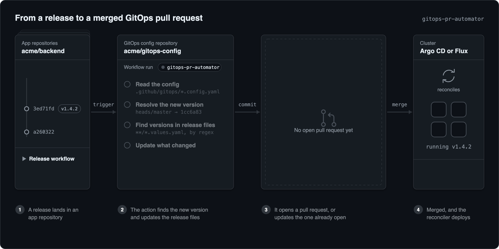
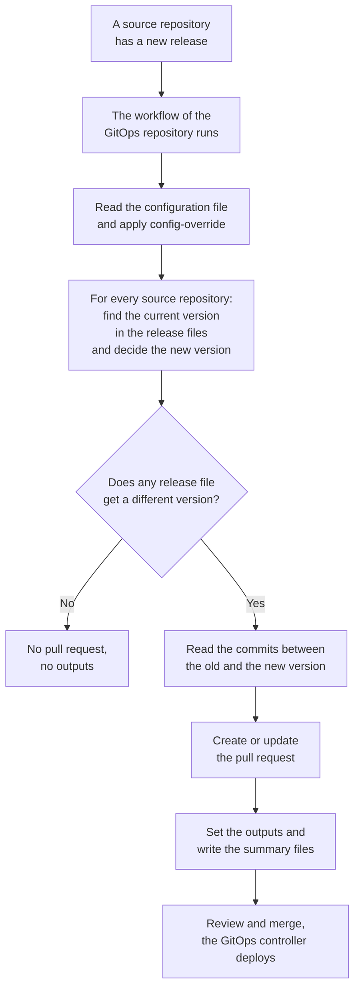
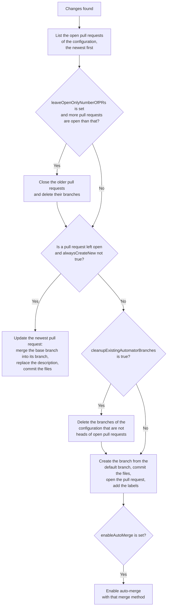
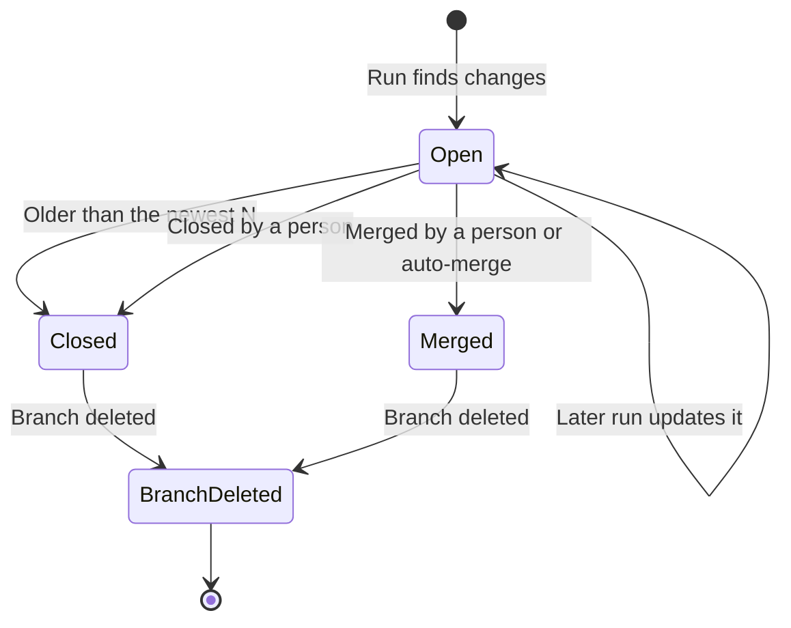

# GitOps PR Automator

[](https://github.com/super-linter/super-linter)

[](https://github.com/abdolence/gitops-pr-automator/actions/workflows/check-dist.yml)
[](https://github.com/abdolence/gitops-pr-automator/actions/workflows/codeql-analysis.yml)
[](./badges/coverage.svg)

A GitHub Action that keeps version references in a GitOps configuration
repository up to date. When a source repository has a new release, the action
opens a pull request against the GitOps repository with the new versions and the
history of commits behind them. Merging the pull request triggers the GitOps
reconciliation, where a controller such as Argo CD or Flux applies the
repository state to the environment.



[Quick start](#quick-start) | [How it works](#how-it-works) |
[Configuration](#configuration) |
[Action inputs and outputs](#action-inputs-and-outputs) |
[Versioning schemes](#versioning-schemes) |
[GitHub tokens and permissions](#github-tokens-and-permissions) |
[Runner requirements](#runner-requirements) | [Security](#security)

The action provides:

- pull requests with the updated versions in the files of the GitOps repository,
  found by regular expressions;
- one pull request kept up to date per configuration, or a new one for every
  release;
- limits on the number of open pull requests and clean-up of the branches left
  behind;
- commit SHAs or tags as versions, or versions given by the workflow trigger;
- the list of commits between the old and the new version in the pull request
  description;
- auto-merge, labels and summary files for later workflow steps.

## Quick start

Three pieces are needed in the GitOps repository and the source repositories: a
configuration file, a workflow that runs the action, and a step in the source
repositories that triggers the workflow.

### Create a configuration file

Add a configuration file to the GitOps repository, for example
`.github/gitops/gitops-pr-automator.config.yaml`:

```yaml
id: my-gitops
pullRequest:
  title: 'GitOps automated release'
sourceRepos:
  - repo: my-org/my-app
    releaseFiles:
      - path: 'apps/my-app/values.yaml'
        regex:
          - '(?<=(tag: ))[a-f0-9]{40}(?=(.*))'
```

The action monitors the head of the `master` branch of `my-org/my-app`. In
`apps/my-app/values.yaml` it looks for 40 hexadecimal characters after `tag:`
and, when the head commit differs, replaces them with the SHA of the head
commit. All options are described in [Configuration](#configuration).

### Create a workflow in the GitOps repository

The workflow must check out the GitOps repository, because the release files and
the configuration file are read from the workflow workspace.

```yaml
name: GitOps PR Automator
on:
  workflow_dispatch:
    inputs:
      # Optional, see the `versions` input in "Action inputs and outputs"
      versions:
        description: 'Versions to set instead of the head of the source repos'
        required: false

concurrency:
  group: ${{ github.workflow }}
  cancel-in-progress: true

jobs:
  create-pr:
    name: Create a PR with updated version references
    runs-on: ubuntu-latest

    # These permissions are sufficient only if a GitHub App token is used.
    permissions:
      contents: read

    steps:
      - name: Checkout
        id: checkout
        uses: actions/checkout@v7

      - name: Create GitOps PR
        id: create-pr
        uses: abdolence/gitops-pr-automator@v1
        # Use abdolence/gitops-pr-automator@v1.5.0 to pin the exact release
        with:
          # Token to read the source repositories and to create pull requests
          # in this repository, see "GitHub tokens and permissions"
          github-token: ${{ secrets.GH_AUTOMATION_TOKEN }}
          config-path: '.github/gitops/gitops-pr-automator.config.yaml'
          # Versions provided by the workflow trigger
          # versions: ${{ inputs.versions }}
```

The `@v1` reference follows the latest `v1.x.y` release; `@v1.5.0` pins the
exact release.

### Trigger the workflow from the source repositories

Add a step to the release workflow of every source repository:

```yaml
- name: Trigger GitOps PR automation
  if: github.ref_protected
  uses: actions/github-script@v9
  with:
    # GitHub token with permissions to trigger workflows in the GitOps
    github-token: ${{ secrets.GH_TRIGGER_WORKFLOWS }}
    script: |
      await github.rest.actions.createWorkflowDispatch({
        owner: '<your-github-owner>',
        repo: '<your-gitops-config-repo>',
        workflow_id: '<github-actions-workflow-file-name>.yaml',
        ref: 'master'
      })
```

The workflow file must declare the `workflow_dispatch` trigger. `ref` is the
branch of the GitOps repository that the workflow runs on. Use the default
branch: pull requests are opened against it, and the contents written to the
pull request branch are taken from the files of the workflow checkout.

To tell the action which versions were released, instead of reading the head of
each source repository, pass them as a workflow input and forward the input to
the `versions` input of the action, as in the workflow above:

```yaml
await github.rest.actions.createWorkflowDispatch({
  owner: '<your-github-owner>',
  repo: '<your-gitops-config-repo>',
  workflow_id: '<github-actions-workflow-file-name>.yaml',
  ref: 'master',
  inputs: {
    versions: '<your-github-owner>/<source-repo>=v1.2.3,<commit-sha>'
  }
})
```

## How it works



A run goes through these steps:

1. The configuration file is read from `config-path`, `config-override` is
   merged into it, and the result is validated. A run with an invalid
   configuration fails with the list of problems.
1. For every item of `sourceRepos`, the files matching each `releaseFiles` entry
   are read from the workspace, and the regular expressions find the current
   version in them.
1. The new version of each file is decided, see
   [Which version is written](#which-version-is-written). A file whose current
   version equals the new one is left out.
1. For each file that changes, the commits from the current commit SHA to the
   new one are read from the source repository, unless `commitHistory.disable`
   is set or one of the two commit SHAs is not known.
1. When no file changes in any source repository, the run ends: no pull request
   is created or updated and no outputs are set.
1. Otherwise the pull request is created or updated, see
   [Pull request lifecycle](#pull-request-lifecycle), the outputs are set and
   the summary files are written.

Source repositories are read with `github-token-read-repos` when it is set, and
with `github-token` otherwise.

### Which version is written

The new version of a release file is the first of these that applies:

1. The version given by the `versions` input for the source repository, when the
   `pathId` of the item is the `id` of the release file or is left out;
1. The tag that points at the head commit of the source repository, when the
   `versioning` scheme is `commit-tags-or-sha` or `commit-tags-only`;
1. Nothing, when the scheme is `commit-tags-only` and there is no such tag: the
   file is left as it is;
1. The full commit SHA of the head commit.

The head commit is the head of the `ref` of the source repository, which is
`heads/master` by default.

### What the pull request contains

The description of the pull request is built from `pullRequestComment`, and
then, for every source repository with changes, a table of the files with their
current and new versions and the list of the commits between them. The commit
subjects link to the commits, and the `#123` references in them link to the pull
requests of the source repository. A commit is followed by `by @login` of its
author when the author is a GitHub account. The Markdown summary file lists the
commits the same way.


### Pull request lifecycle

What a run does with the pull requests of the configuration, when it found
changes:



The state of a pull request created by the action:



- Open to open: a later run that finds changes updates the newest pull request,
  unless `alwaysCreateNew` is `true`, which creates a new pull request instead;
- Open to closed: the pull requests beyond the newest `leaveOpenOnlyNumberOfPRs`
  are closed by the action, which deletes their branches;
- Open to merged: with `enableAutoMerge` set, GitHub merges the pull request
  with that method as soon as the repository requirements are met; otherwise a
  person merges it;
- Branch deleted: besides the branches of the pull requests closed by
  `leaveOpenOnlyNumberOfPRs`, `cleanupExistingAutomatorBranches` deletes the
  branches left by other pull requests when a new pull request is created.

## Configuration

A configuration file is a YAML document with these top-level options:

- `id` (required): unique identifier of the configuration. Branch names of the
  pull requests start with it, and the action finds its own open pull requests
  by it, so every configuration of a GitOps repository needs its own id;
- `pullRequest` (required): the pull request parameters, see
  [Pull request options](#pull-request-options);
- `sourceRepos` (required): the repositories to monitor, see
  [Source repositories and release files](#source-repositories-and-release-files);
- `versioning`: which version is written to the files, see
  [Versioning schemes](#versioning-schemes);
- `regex`: regular expressions to match and replace the version, used by the
  release files that have no `regex` of their own;
- `githubShaRegex`: regular expressions to match the commit SHA in a file, used
  by the release files that have no `githubShaRegex` of their own;
- `artifacts`: files with the summary of the changes, see
  [Summary files](#summary-files).

An example with most of the options:

```yaml
# Unique identifier for the configuration. It is used to create branch names
# and to find the pull requests of this configuration.
id: gitops-pr-automator
# Parameters of the pull requests created
pullRequest:
  title: 'GitOps automated release'
  githubLabels:
    - gitops
    - gitops-test
  enableAutoMerge: 'squash'
  pullRequestComment: |
    This PR was automatically created by the GitOps PR Automator.
    Please review the changes and merge if they look good.
  commitHistory:
    disable: false # Set to true to leave the commit history out
    onlyMergeCommits: false # Set to true to include only merge commits

  # Manage the lifecycle of the pull requests created by the action
  # alwaysCreateNew: true
  # leaveOpenOnlyNumberOfPRs: 2
  # cleanupExistingAutomatorBranches: true

# Regular expressions for all release files, which a release file can replace
# regex:
#   - '(?<=(tag: ))[a-f0-9]{40}(?=(.*))'

# Source repositories to monitor for new releases
sourceRepos:
  - repo: abdolence/gitops-pr-automator # Repository to monitor
    ref: heads/master # Branch to monitor
    # Files of the GitOps repository that hold the version
    releaseFiles:
      - path: '**/*.values.yaml' # Glob syntax to match files
        # Regex to both match and replace the version in the file
        regex:
          - '(?<=(tag: ))[a-f0-9]{40}(?=(.*))'
```

The file is parsed as YAML with the core schema and merge keys (`<<`, which copy
the keys of another mapping into the current one), so anchors and merge keys can
share fragments of the file. `config-override` is parsed the same way.

### Pull request options

- `title` (required): the title of a new pull request;
- `githubLabels`: labels added to a new pull request;
- `enableAutoMerge`: `squash`, `rebase` or `merge`. Enables auto-merge with this
  merge method on a new pull request. The repository has to allow auto-merge;
- `pullRequestComment`: the text at the start of the pull request description;
- `commitHistory`: the list of commits in the pull request description.
  `disable: true` leaves the list out. `onlyMergeCommits: true` keeps only the
  commits that have more than one parent or mention a pull request number
  (`#123`);
- `includeGitHubOwnerInDescription`: shows source repositories as `owner/repo`
  instead of `repo` in the pull request description and in the Markdown summary
  file;
- `alwaysCreateNew`: when `true`, every run that finds changes creates a new
  branch and pull request. Otherwise the action updates the open pull request of
  the configuration if there is one;
- `leaveOpenOnlyNumberOfPRs`: a positive whole number. Open pull requests of the
  configuration are sorted by creation date, newest first, and only that number
  stay open. The older ones are closed and their branches deleted. A pull
  request created in the same run is not counted. Leave the option out to keep
  every pull request open;
- `cleanupExistingAutomatorBranches`: when `true`, before a new pull request is
  created, the branches of the GitOps repository named `<id>-<timestamp>` are
  deleted, except the branches of open pull requests.

A branch belongs to a configuration only when it is named exactly
`<id>-<timestamp>`, where the timestamp is the UTC time of the run with `-` in
place of `:` and `.`, for example `app-2026-11-08T10-15-30-123Z`. Configurations
with ids such as `app` and `app-staging` can therefore share a GitOps
repository. The pull requests of a configuration are the open pull requests with
such a branch.

When there is one and `alwaysCreateNew` is not set, the action updates the
newest of them: it merges the base branch into the pull request branch, replaces
the description and commits the updated files to the same branch. Labels and
auto-merge are set only when the pull request is created. Otherwise it creates a
branch named `<id>-<timestamp>` from the default branch of the GitOps repository
and opens a pull request against it.

### Source repositories and release files

Each item of `sourceRepos` has:

- `repo` (required): the repository to monitor, as `owner/name`;
- `ref`: the git reference whose head commit is the new version, for example
  `heads/master` or `heads/main`. Default is `heads/master`;
- `releaseFiles`: the files of the GitOps repository that hold the version of
  this source repository.

Each item of `releaseFiles` has:

- `path` (required): a glob pattern for the files, relative to the workspace;
- `ignore`: a glob pattern, relative to the workspace, for the files matched by
  `path` that are left out;
- `regex`: regular expressions to match and replace the version in these files.
  Replaces the top-level `regex` for them;
- `githubShaRegex`: regular expressions to match the commit SHA in these files.
  Replaces the top-level `githubShaRegex` for them;
- `id`: an identifier of the release file, which the `versions` input of the
  action refers to as `pathId`.

The version found by `regex` is compared with the new version, and the file is
changed only when they differ. The commit history in the pull request is read
from the commit SHA of the current version to the commit SHA of the new one.
Without `githubShaRegex` the version itself is used as the current commit SHA,
which is right for the `commit-sha-only` scheme. With tags as versions,
`githubShaRegex` finds the commit SHA stored next to the tag in the file (the
first match of the first expression that matches), and it is replaced with the
new commit SHA together with the version:

```yaml
releaseFiles:
  - path: 'apps/backend/values.yaml'
    id: 'backend'
    regex:
      - '(?<=(version: ))v[0-9]+\.[0-9]+\.[0-9]+(?=(.*))'
    githubShaRegex:
      - '(?<=(github-sha: ))[a-f0-9]{40}(?=(.*))'
```

### Regular expressions

The `regex` field describes both how to match the version string in a file and
how to replace it. The whole text matched by a regular expression is replaced
with the new version. Lookbehind and lookahead assertions (`(?<=...)` and
`(?=...)`) check the text around the version without making it part of the
match, so they are the way to anchor the version to its key and leave the key as
it is.

In the examples above, the action looks for a string of 40 hexadecimal
characters following `tag:` and replaces it with the new version. Several
expressions can be listed in `regex`. Expressions run with the `g` and `m`
flags, and every match of the expression in a file is replaced.

Some other useful examples of regular expressions:

- `(?<=(tag: ))[0-9]+\.[0-9]+\.[0-9]+(?=(.*))` - match and replace semantic
  versioning;
- `(?<=(image.tag\n(\s)*value:\s))[a-f0-9]{40}(?=(.*))` - match and replace the
  version in the Helm chart values file.

### Summary files

`artifacts` writes the detected changes to files in the workspace, for example
to upload them in a later step. The directories are created when they do not
exist, and the files are written only when changes were found:

- `summaryMarkdownAs`: the path of a Markdown file with the version changes and
  the commits of every changed source repository;
- `summaryJsonAs`: the path of a JSON file with the detected changes.

## Action inputs and outputs

Inputs:

- `github-token` (required): the token for the GitOps repository, see
  [GitHub tokens and permissions](#github-tokens-and-permissions);
- `github-token-read-repos`: the token to read the source repositories, see
  [GitHub tokens and permissions](#github-tokens-and-permissions);
- `config-path`: the path of the configuration file. Default is
  `.github/gitops/gitops-pr-automator.config.yaml`;
- `config-override`: YAML merged into the configuration file, see
  [Overriding the configuration](#overriding-the-configuration);
- `versions`: the versions to write instead of the head of each source
  repository (or its tag). The format is
  `<repo1>:<pathId>=<version>,<versionSha>;<repo2>=<version>,<versionSha>`: a
  list separated by `;` of the source repository, optionally followed by `:` and
  the `id` of a release file, then `=` the version and `,` the commit SHA of the
  version. Without the `pathId` the version is used for all release files of the
  repository. The commit SHA is used for the commit history, and the commit
  history of a file is left out without it. Items that do not have exactly one
  `=` are ignored.

Outputs are set only when changes were found; they refer to the created pull
request or to the updated one:

- `detected-changes`: the source repositories with detected changes, separated
  by a comma and a space;
- `pull-request-url`: the URL of the pull request;
- `pull-request-number`: the number of the pull request;
- `pull-request-id`: the ID of the pull request, which is GitHub's internal
  identifier and not the number.

For example, to use the number in a later step:

```yaml
- name: Create GitOps PR
  id: create-pr
  uses: abdolence/gitops-pr-automator@v1
  with:
    github-token: ${{ secrets.GH_AUTOMATION_TOKEN }}

- name: Show the pull request
  if: steps.create-pr.outputs.pull-request-number
  run: echo "${{ steps.create-pr.outputs.pull-request-url }}"
```

### Overriding the configuration

`config-override` is YAML in the same format as the configuration file. It is
merged into the file before the configuration is validated:

- objects are merged by key;
- a single value in the override replaces the value of the file;
- lists are concatenated and repeated items are dropped. Strings that are
  already in the list of the file are not added again. Items that are objects,
  such as the entries of `sourceRepos`, are always added.

For example, to add a label to the pull requests of one workflow:

```yaml
config-override: |
  pullRequest:
    githubLabels:
      - gitops-test-override
```

## Versioning schemes

The version written to the release files is chosen by the `versioning` block of
the configuration file:

```yaml
versioning:
  scheme: 'commit-tags-or-sha'
  resolveTagsPattern: 'v[0-9]+\.[0-9]+\.[0-9]+'
```

`scheme` is required when the block is present, and supports the following
values:

- `commit-sha-only` - the full commit SHA of the source repository, default mode
  when there is no `versioning` block;
- `commit-tags-or-sha` - the tag of the source repository that points at the
  head commit, and if there is none, the full commit SHA;
- `commit-tags-only` - the tag of the source repository that points at the head
  commit. When there is none, the release files of that source repository are
  not changed.

The tags are read from the source repository with the GitHub repository tags
API, all pages of it. `resolveTagsPattern` is a regular expression tested
against the full tag reference (`refs/tags/<tag>`) and is not anchored. Only the
tags that match it are considered. When it is not set, tags containing
`v<major>.<minor>.<patch>` (for example `v1.5.0`) are considered. A tag is
matched to the head commit by the commit it points at, for both lightweight tags
and annotated tags (tags that are objects of their own, with a message). When
several matching tags point at the head commit, the last one returned by the API
is used.

When a tag is used, the `regex` of the release files has to match a tag in the
file (for example `v1.5.0`), not a commit SHA. Set `githubShaRegex` as well to
keep the commit history in the pull request, see
[Source repositories and release files](#source-repositories-and-release-files).

## GitHub tokens and permissions

Recommended way to use the GitHub token is to create a separate GitHub
application, following this
[guide](https://docs.github.com/en/apps/creating-github-apps/authenticating-with-a-github-app/making-authenticated-api-requests-with-a-github-app-in-a-github-actions-workflow).
In this case you can restrict the application to the particular repositories and
scope.

The action uses two tokens:

- `github-token` (required): used in the GitOps repository to create branches,
  commit the updated files, create and update pull requests, add labels, enable
  auto-merge, and close pull requests and delete branches when the pull request
  options ask for it. It needs write access to the contents and the pull
  requests of the GitOps repository, which is why a fine-grained token or a
  GitHub App token is the better choice;
- `github-token-read-repos` (optional): used to read the source repositories
  (head commit, tags and commit history). It needs read access to the contents
  of the source repositories. When it is not set, `github-token` is used for
  this as well. A separate token keeps read access to the source repositories
  out of the token that can write to the GitOps repository.

The `permissions` of the workflow job apply to `GITHUB_TOKEN` only. Reading the
repository contents is sufficient when the tokens passed to the action are a
GitHub App token or a fine-grained token, as in the workflow above.

The token that triggers the workflow from the source repositories, used in the
trigger step above, needs permission to run workflows in the GitOps repository.

## Runner requirements

The action runs on Node.js 24 (`runs.using: node24`). GitHub-hosted runners
support it. Self-hosted runners need the runner application v2.327.1 or newer.

## Security

This action uses the GitHub token provided to create pull requests and also read
commit history. Ensure that the token has the necessary permissions to create
pull requests and read commit history.

The action is written in TypeScript and compiled to JavaScript in `dist/`, which
runs on the Node.js runtime of the GitHub Actions runner (`node24`); it does not
download or execute any other binary. It uses GitHub Actions Toolkit and a small
number of dependencies, which keeps the code easier to audit.

To report a vulnerability, follow [SECURITY.md](SECURITY.md).

## Licence

Apache License 2.0, see [LICENSE](LICENSE).

## Author

Abdulla Abdurakhmanov
